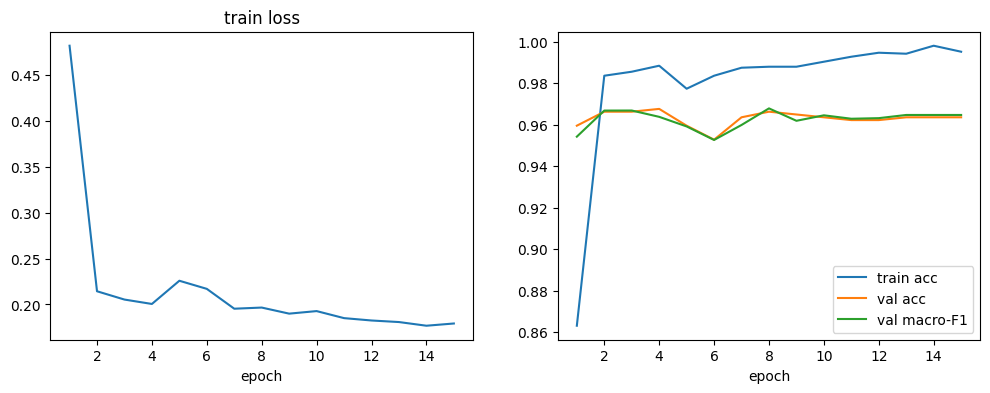
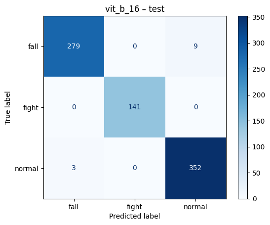
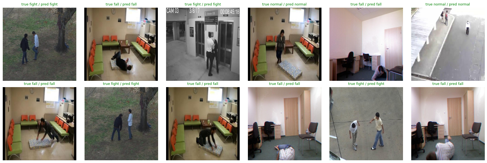
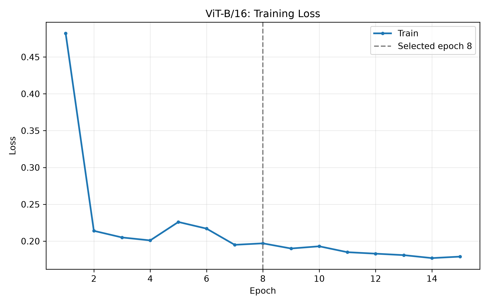
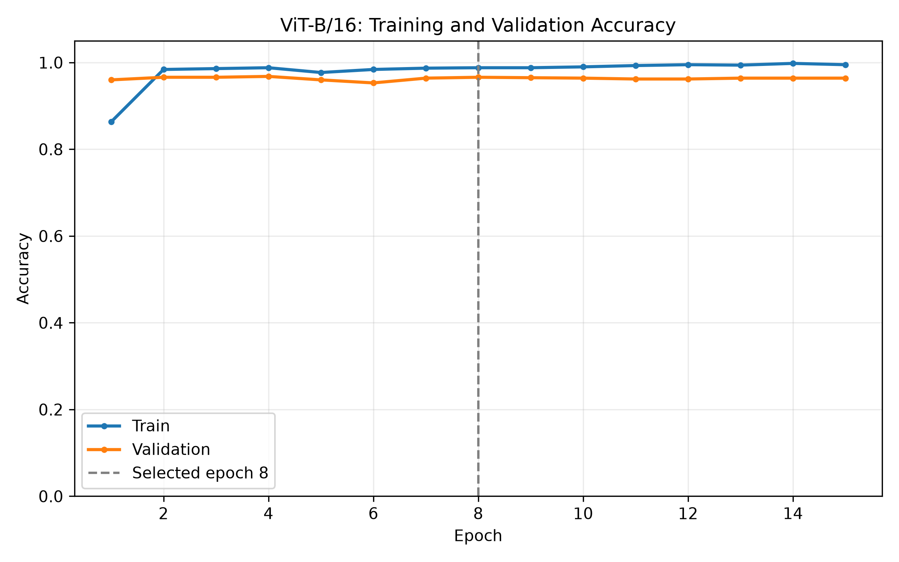
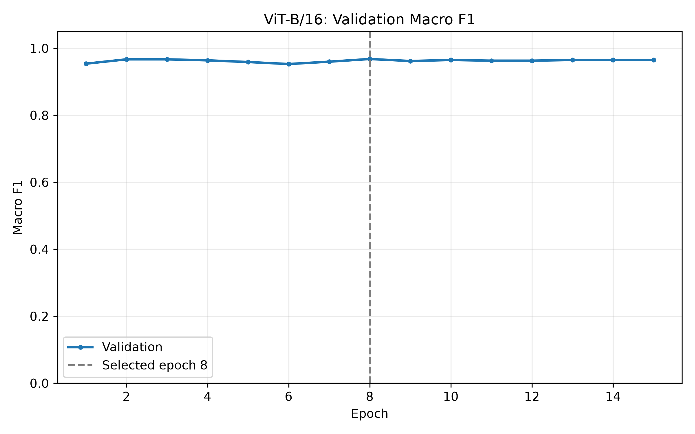
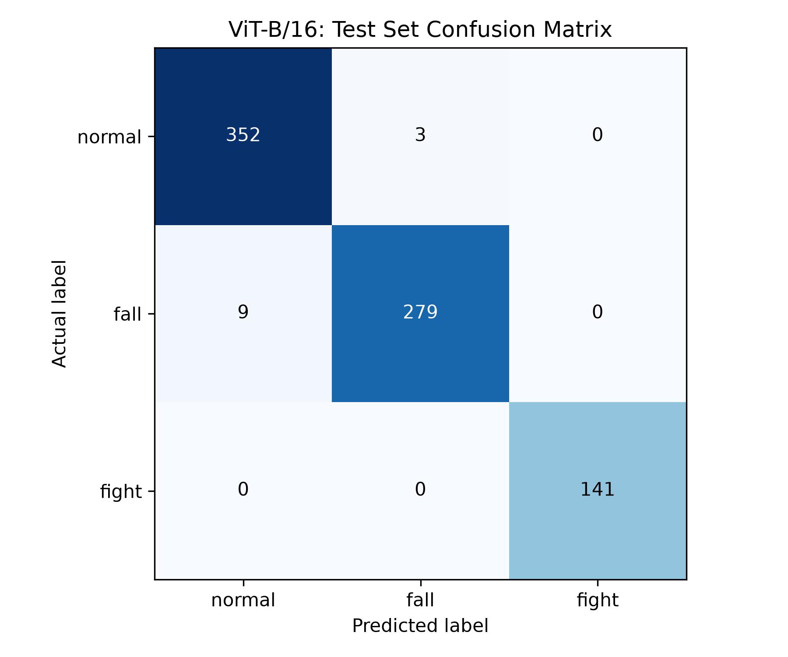
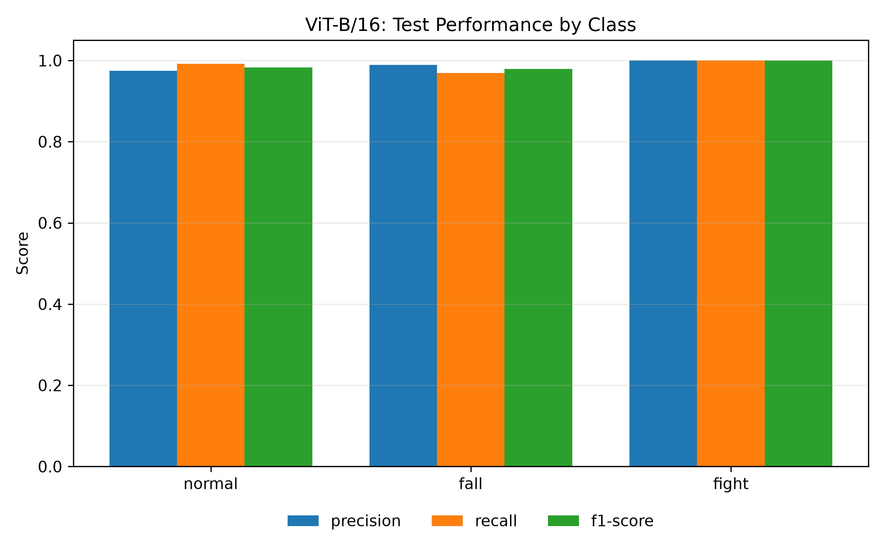

# Abnormal Crowd Behavior Detection with a Vision Transformer

Frame-level classification of surveillance images into **normal**, **fall** and **fight** using a Vision Transformer (ViT-B/16).

> Part of the [DL-proj](https://github.com/anikagupta2403/DL-proj) comparison of 2D CNN, 3D CNN and Transformer models. See `main` for the project overview and [`2d-cnn`](https://github.com/anikagupta2403/DL-proj/tree/2d-cnn) for the CNN baselines.

| | |
|---|---|
| Run | [`abnormal-crowd-vit.ipynb`](abnormal-crowd-vit.ipynb) (executed, with outputs) |
| Weights | `vit_best.pt` (343 MB): not in the repo, because GitHub rejects files over 100 MB |
| Figures | [`results/`](results/) |

The run was done on Kaggle (T4 GPU) with **exactly the same data pipeline, split, seed and augmentation as the 2D CNN branch**, so the results are directly comparable.

---

## 1. Dataset

**Source:** [Roboflow Universe – Abnormal Behavior Detection v1](https://universe.roboflow.com/abnormal-behavior-detection/abnormal-behavior-detection-5geje/dataset/1) (CC BY 4.0), exported in YOLOv8 format, 3,709 images.

The preprocessing is shared with the 2D CNNs and is described in full in the [`2d-cnn` README](https://github.com/anikagupta2403/DL-proj/tree/2d-cnn#1-dataset). In short:

- The 6 raw classes `['0', '1', '2', 'fall', 'fight', 'normal']` are merged into 3 (`0 → normal`, `1 → fall`, `2 → fight`), see [`results/label_sanity_check.png`](results/label_sanity_check.png).
- Each image gets one label from its boxes: **fight > fall > normal**.
- 109 exact duplicates and 1 empty label are removed, leaving **3,599 images** (1,200 fall / 1,199 fight / 1,200 normal).
- Images are grouped by source video (218 groups, long numbered sequences cut into blocks of 100 frames) and split with `StratifiedGroupKFold` (seed 42), so **no video is in more than one split**.

| Split | fall | fight | normal | Total |
|---|---|---|---|---|
| Train | 668 | 725 | 681 | 2,074 |
| Validation | 244 | 333 | 164 | 741 |
| Test | 288 | 141 | 355 | 784 |

- **Resizing:** 224×224, the input size ViT-B/16 was pretrained on.
- **Normalization:** ImageNet mean/std, which the pretrained weights expect.
- **Augmentation (training only):** `RandomResizedCrop(224, scale=(0.6, 1.0))`, `RandomHorizontalFlip`, `ColorJitter(0.3, 0.3, 0.3, 0.05)`. No mosaic, since a stitched image has no single label.

---

## 2. Model: ViT-B/16 (ImageNet-pretrained, fine-tuned)

**Why we selected it**
- It is the standard transformer for images and fills the project's Transformer slot. Comparing it with ResNet-18 on the same split isolates the effect of the architecture: self-attention vs. convolution.
- A CNN only sees a small neighbourhood per layer and builds up global context slowly. Self-attention relates every image region to every other from the first layer, which could help with scenes where the behavior depends on several people or the whole frame.
- Transformers have weak built-in assumptions about images, so they need a lot of data. With only ~2.1k training images, training from scratch is not realistic, so we fine-tune ImageNet-pretrained weights.

**How it works**
- **Patch embedding:** the 224×224 image is cut into 14×14 = **196 patches** of 16×16 pixels. Each patch is flattened and linearly projected to a 768-dimensional token.
- **[CLS] token and position embeddings:** a learnable [CLS] token is prepended, and learned position embeddings are added so the model knows where each patch came from.
- **Encoder:** 12 transformer layers, each with multi-head self-attention (12 heads) and an MLP, with residual connections and layer norm.
- **Head:** the final [CLS] token summarizes the image. We replaced the 1000-class ImageNet head with `Dropout(0.3) → Linear(768, 3)` and fine-tuned the whole network end to end.

**Implementation**

```python
m = torchvision.models.vit_b_16(weights=torchvision.models.ViT_B_16_Weights.DEFAULT)
m.heads = nn.Sequential(nn.Dropout(0.3), nn.Linear(m.hidden_dim, len(CLASSES)))
```

| Setting | Value |
|---|---|
| Parameters | 85.80 M |
| Epochs | 15 |
| Batch size | 32 |
| Optimizer | AdamW, weight decay 1e-4 |
| Learning rate | OneCycle, peak **1e-4** (ResNet-18 used 3e-4; full ViT fine-tuning is unstable that high) |
| Loss | Cross-entropy, inverse-frequency class weights, label smoothing 0.05 |
| Precision | Mixed (`torch.autocast` + `GradScaler`) |
| Checkpoint | Best validation macro-F1 |

**Training**

| Epoch | Train loss | Train acc | Val acc | Val macro-F1 |
|---|---|---|---|---|
| 1 | 0.482 | 0.863 | 0.960 | 0.954 |
| 2 | 0.214 | 0.984 | 0.966 | 0.967 |
| **8 (best)** | 0.197 | 0.988 | 0.966 | **0.968** |
| 15 | 0.179 | 0.995 | 0.964 | 0.965 |

The pretrained ViT is already at 0.954 validation macro-F1 after one epoch. After epoch 2, validation scores stay flat at about 0.96 while training accuracy keeps climbing to 0.995, so more epochs would not help.



**Test results** (784 images, videos never seen in training)

| Class | Precision | Recall | F1 | Support |
|---|---|---|---|---|
| fall | 0.989 | 0.969 | 0.979 | 288 |
| fight | 1.000 | 1.000 | 1.000 | 141 |
| normal | 0.975 | 0.992 | 0.983 | 355 |
| **Macro avg** | 0.988 | 0.987 | **0.987** | 784 |
| **Accuracy** | | | **0.985** | 784 |

Confusion matrix (rows = true, columns = predicted): fall 279 / 0 / 9, fight 0 / 141 / 0, normal 3 / 0 / 352. That is 12 errors out of 784.





---

### Graphs

The same set of graphs as the 3D CNN branch. The dashed line marks epoch 8, whose weights were kept for testing. The notebook logged only training loss per epoch (no validation loss) and only validation macro-F1 (no training F1), so those curves have a single line.

| | |
|---|---|
|  |  |
|  |  |
|  | |

## 3. Comparison with the 2D CNNs

| | ViT-B/16 | ResNet-18 | Custom CNN |
|---|---|---|---|
| Parameters | 85.80 M | 11.18 M | 1.17 M |
| Pretrained | ImageNet | ImageNet | No |
| Epochs (best epoch) | 15 (8) | 15 (9) | 40 (21) |
| Best val macro-F1 | 0.968 | 0.988 | 0.944 |
| **Test accuracy** | 0.985 | **0.992** | 0.969 |
| **Test macro-F1** | 0.987 | **0.994** | 0.969 |
| Test errors | 12 / 784 | 6 / 784 | 24 / 784 |
| Fall recall | 0.969 | 1.000 | 1.000 |
| Normal recall (false-alarm side) | **0.992** | 0.983 | 0.932 |

- **ViT does not beat ResNet-18**, despite having almost 8× more parameters. On ~2k training images, a CNN's built-in assumptions (locality, translation invariance) are an advantage, and the dataset is too easy for global attention to add much.
- **It makes a different kind of error.** Both CNNs never miss an abnormal event and all their errors are false alarms. The ViT has the fewest false alarms (3), but it is the only model that **misses falls** (9 falls predicted as normal). In surveillance, a missed fall is usually the more costly error.
- **Fight is perfect for all three models**, likely because the fight videos come from visually distinct scenes.

---

## 4. Limitations

- **Same dataset limits as the CNNs:** no crowd panic class, and the scene can give away the class (falls come from a few indoor rooms, fights from outdoor scenes). See the [`2d-cnn` README](https://github.com/anikagupta2403/DL-proj/tree/2d-cnn#4-limitations).
- **Small, uneven test split.** The gap between ViT and ResNet-18 is 6 images, which is within what a different split could change.
- **No temporal information.** Like the 2D CNNs, the ViT sees one frame at a time. A video transformer would need ordered clips, which this dataset mostly lacks.
- **Heavy model.** At 343 MB and 85.8M parameters, it is much slower and larger than ResNet-18 for a slightly lower score.

---

## 5. How to Reproduce

1. Download the dataset from Roboflow (format: **YOLOv8**) and upload it as a Kaggle dataset.
2. Open `abnormal-crowd-vit.ipynb` on Kaggle, set **Accelerator → GPU** and **Internet → on** (to download the pretrained weights, ~330 MB), and point `DATA_ROOT` at the dataset.
3. Restart the session after changing the accelerator, then click **Run All**. The first cell should print `device: cuda`. The best checkpoint is saved as `best.pt`.

Settings: `MODEL = "vit_b_16"`, `EPOCHS = 15`, `BATCH_SIZE = 32`, `LR = 1e-4`. If you run out of GPU memory, use `BATCH_SIZE = 16`.

Requirements: Python 3, PyTorch, torchvision, scikit-learn, pandas, matplotlib, Pillow, PyYAML (all preinstalled on Kaggle).
