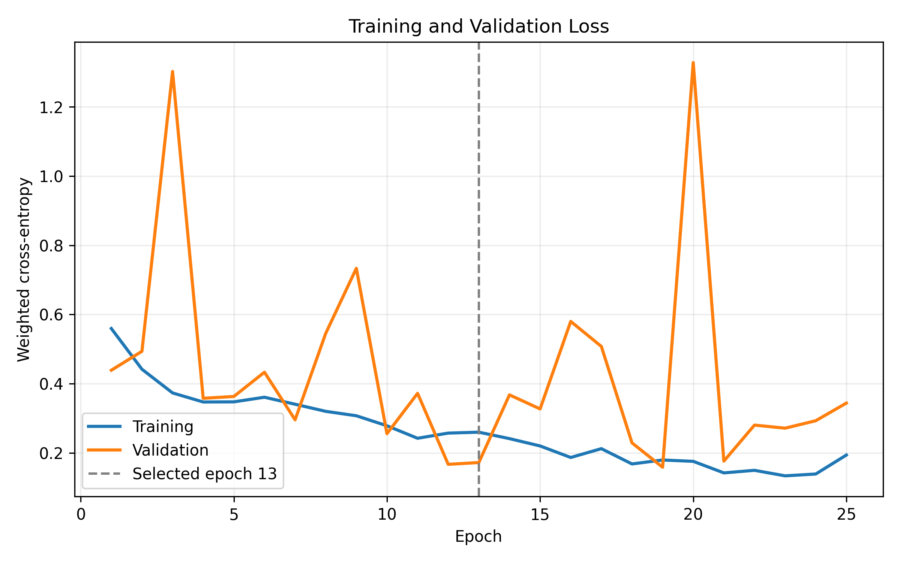
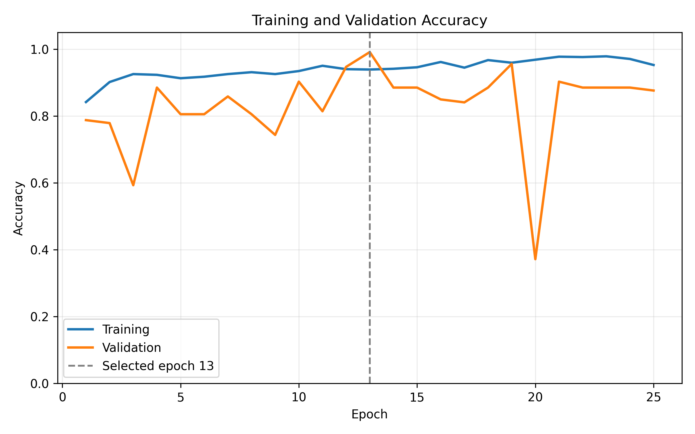
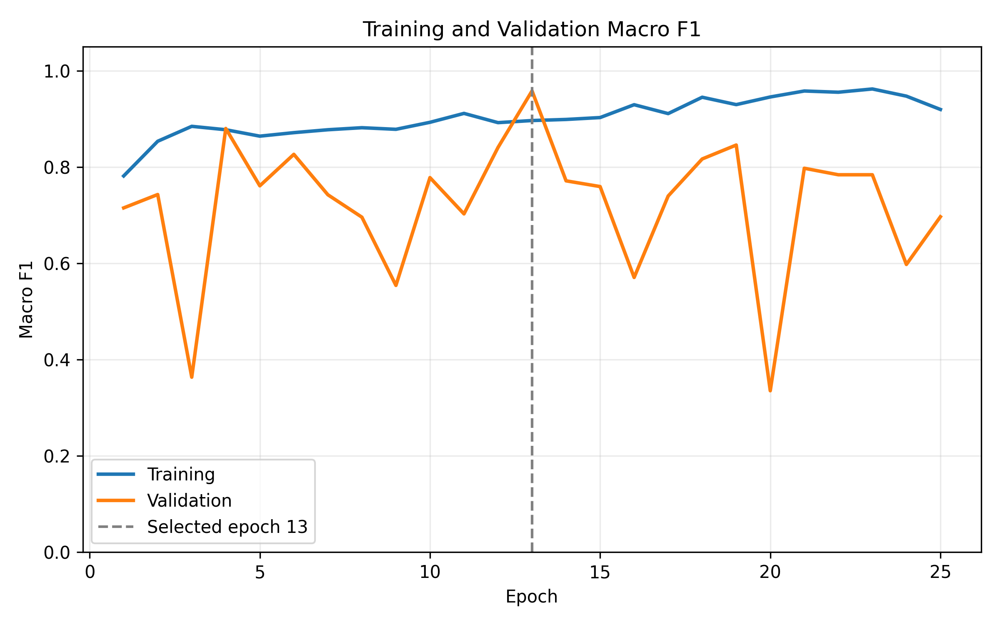
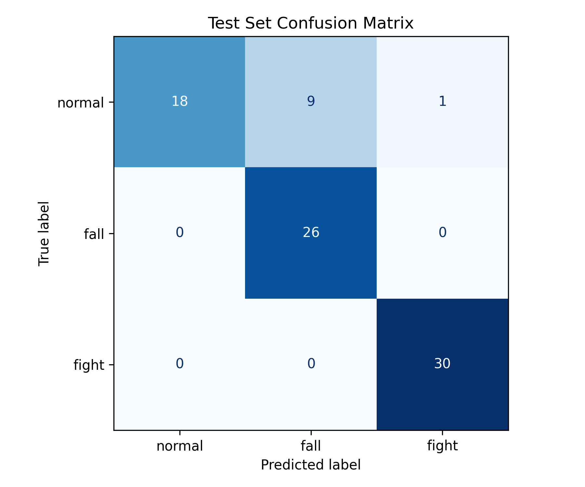
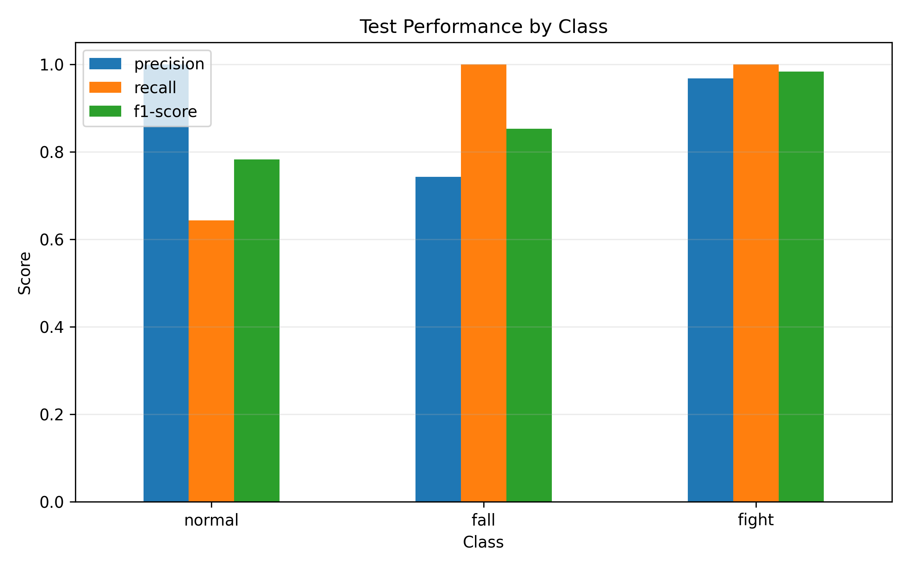

# Abnormal Crowd Behavior Detection with a 3D CNN

Clip-level classification of surveillance video into **normal**, **fall** and **fight** using a small 3D CNN that looks at **4 consecutive frames at once**.

> Part of the [DL-proj](https://github.com/anikagupta2403/DL-proj) comparison of 2D CNN, 3D CNN and Transformer models. See `main` for the project overview, [`2d-cnn`](https://github.com/anikagupta2403/DL-proj/tree/2d-cnn) for the CNN baselines and [`transformer`](https://github.com/anikagupta2403/DL-proj/tree/transformer) for the ViT.

| | |
|---|---|
| Run | [`3d_cnn.ipynb`](3d_cnn.ipynb) (executed on Kaggle, Tesla T4, with outputs) |
| Weights | [`best_3d_cnn.pt`](best_3d_cnn.pt) (0.9 MB, best epoch 13) |
| Results | [`results/`](results/): curves, confusion matrix, per-class metrics, per-clip predictions, exact clip splits |

The 2D models see one frame at a time, so they can only use what a person looks like. A 3D CNN also convolves over **time**, so in principle it can use how people move. This branch tests whether that helps on this dataset.

---

## 1. Dataset

**Source:** [Roboflow Universe – Abnormal Behavior Detection v1](https://universe.roboflow.com/abnormal-behavior-detection/abnormal-behavior-detection-5geje/dataset/1) (CC BY 4.0), exported in YOLOv8 format, 3,709 images.

### Labels

The same label rules as the 2D models:
- The 6 raw classes `['0', '1', '2', 'fall', 'fight', 'normal']` are merged into 3: `0 → normal`, `1 → fall`, `2 → fight`. The numbered classes were checked visually in the 2D notebooks and are a second name for the same behaviors.
- A frame gets one label from its boxes. Any abnormal person makes the frame abnormal (fight / fall over normal). Frames with no boxes, or with both fall and fight boxes, are dropped.

### Same split as the 2D models

The notebook first rebuilds the 2D notebooks' split exactly: the same duplicate removal (109 exact duplicates), the same video groups, `StratifiedGroupKFold` and seed 42. It then stops with an error unless it gets the same **2,074 / 741 / 784** frames. Every clip goes into the split its source video was in, so **the 3D CNN is tested on the same held-out videos as ResNet-18, the Custom CNN and the ViT**, and no video is in more than one split.

> scikit-learn 1.8 changed how `StratifiedGroupKFold` shuffles, which gives a different split. Kaggle currently ships an older version. If the check fails, run `pip install scikit-learn==1.7.2` and restart.

### Frame sequence preparation

A 3D CNN needs ordered frames, but Roboflow exports independent images. Clips are rebuilt from the filenames:

1. **Parse source video and frame number** from names like `fall-07-cam0-rgb-034_png` or `seq12-frame_17_png`.
2. **Sort each video's frames** by frame number and remove repeated frames.
3. **Slide a 4-frame window** over each video. A window becomes a clip only if all 4 frames have the **same label** and no gap between frames is larger than **20** frame numbers, so a clip never jumps across a large part of the video.

The 1,640 images in the long numbered sequences (`000004_png`, `p1007_png`) have no video name in the filename, so they can't be put in order and are not used. The 3D CNN therefore trains on fewer, more fall- and fight-heavy videos than the 2D models.

### Overlapping training clips, non-overlapping evaluation clips

| Split | Window step | Clips | normal | fall | fight |
|---|---|---|---|---|---|
| Train | 1 frame (clips overlap) | 884 | 134 | 193 | 557 |
| Validation | 4 frames (no overlap) | 113 | 5 | 34 | 74 |
| Test | 4 frames (no overlap) | 84 | 28 | 26 | 30 |

**Why the split is handled this way:**
- **Training clips overlap** (step 1, so neighbouring clips share 3 of 4 frames). Without overlap there would be only **255** training clips, which is too few even for a small 3D CNN. With overlap there are **884** (about 3.5× more). It also works as temporal augmentation: the model sees the same motion starting at different frames. This **can't inflate the scores**, because validation and test come from different videos.
- **Validation and test clips don't overlap** (step 4). Every evaluation frame is counted once, the same as in the 2D models. Overlapping test clips would be near-copies of each other, making the test set look bigger and the result look more certain than it is.

### Preprocessing and augmentation
- Each frame is resized to **112×112** (the usual 3D CNN input size, and it keeps a 4-frame clip cheap) and scaled to [0, 1].
- A clip is a tensor of shape `3 × 4 × 112 × 112` (channels × frames × height × width).
- **Augmentation (training only):** a random horizontal flip, applied **to all 4 frames together** so the motion stays consistent.

---

## 2. Model: Crowd3DCNN (trained from scratch)

**Why we selected it**
- It is the simplest model that uses **motion**. A 3D convolution kernel covers 3 frames × 3×3 pixels, so the network can respond to change over time (falling, punching) and not only to poses.
- It is small (**~71k parameters**) because there are under 900 training clips. A large video network (C3D, I3D) would overfit badly without video pretraining.

**Architecture**

| Block | Layers | Output (C × T × H × W) |
|---|---|---|
| Input | 4 RGB frames | 3 × 4 × 112 × 112 |
| 1 | Conv3d 3→16, k=3 · BatchNorm3d · ReLU · MaxPool3d(1,2,2) | 16 × 4 × 56 × 56 |
| 2 | Conv3d 16→32, k=3 · BatchNorm3d · ReLU · MaxPool3d(2,2,2) | 32 × 2 × 28 × 28 |
| 3 | Conv3d 32→64, k=3 · BatchNorm3d · ReLU · AdaptiveAvgPool3d(1) | 64 × 1 × 1 × 1 |
| Head | Flatten · Dropout(0.4) · Linear 64→3 | 3 |

The first pooling layer only shrinks space (`(1,2,2)`), so all 4 frames are kept through the first block and time is only halved in the second.

**Training setup**

| Setting | Value |
|---|---|
| Parameters | ~71 k |
| Epochs | 25 |
| Batch size | 16 |
| Optimizer | Adam, LR 1e-3, weight decay 1e-4 |
| Loss | Cross-entropy with class weights from training clips (normal 2.20, fall 1.53, fight 0.53) |
| Checkpoint | Best validation macro-F1 |
| Seed | 42 |
| Hardware / time | Kaggle Tesla T4, 10.1 min |

---

## 3. Results

### Training

| Epoch | Train loss | Train acc | Val acc | Val macro-F1 |
|---|---|---|---|---|
| 1 | 0.559 | 0.842 | 0.788 | 0.715 |
| 4 | 0.347 | 0.923 | 0.885 | 0.880 |
| **13 (best)** | 0.260 | 0.939 | **0.991** | **0.958** |
| 20 | 0.176 | 0.968 | 0.372 | 0.335 |
| 25 | 0.194 | 0.952 | 0.876 | 0.697 |

Training loss goes down steadily, but **validation jumps around a lot** (macro-F1 between 0.34 and 0.96). Validation has only 5 normal clips, so one or two clips switching class moves the macro-F1 by 0.1 or more. The best epoch (13) was probably partly luck, and the full log is in [`results/training_history.csv`](results/training_history.csv).

### Test (84 clips from held-out videos)

| Class | Precision | Recall | F1 | Support |
|---|---|---|---|---|
| normal | 1.000 | 0.643 | 0.783 | 28 |
| fall | 0.743 | 1.000 | 0.853 | 26 |
| fight | 0.968 | 1.000 | 0.984 | 30 |
| **Macro avg** | 0.904 | 0.881 | **0.873** | 84 |
| **Accuracy** | | | **0.881** | 84 |

Confusion matrix (rows = true, columns = predicted): normal 18 / 9 / 1, fall 0 / 26 / 0, fight 0 / 0 / 30.

**Where the errors are.** All 10 errors are **normal clips that come from fall videos**: the person standing or walking before or after the fall (videos `fall-01`, `fall-07`, `fall-09`, `fall-29`). Of the 13 normal test clips taken from fall videos, 10 are called fall (9) or fight (1). All 15 normal clips from everyday-activity videos (`adl-*`) are correct. The model has learned "this room / this kind of video means fall" more than "this motion is a fall". Every fall and every fight is caught; the cost is false alarms.

---

## 4. Comparison with the other models

| | 3D CNN | ResNet-18 | Custom CNN | ViT-B/16 |
|---|---|---|---|---|
| Input | 4-frame clip | 1 frame | 1 frame | 1 frame |
| Parameters | ~0.07 M | 11.18 M | 1.17 M | 85.80 M |
| Pretrained | No | ImageNet | No | ImageNet |
| Test units | 84 clips | 784 frames | 784 frames | 784 frames |
| **Test accuracy** | 0.881 | **0.992** | 0.969 | 0.985 |
| **Test macro-F1** | 0.873 | **0.994** | 0.969 | 0.987 |
| Fall recall | 1.000 | 1.000 | 1.000 | 0.969 |
| Normal recall | 0.643 | 0.983 | 0.932 | **0.992** |

- **All four models are tested on the same held-out videos**, but the 3D CNN is scored on 84 clips (336 frames from videos with usable filenames), while the 2D models are scored on all 784 test frames. The numbers show the trend but are not an exact head-to-head.
- **The 3D CNN is the weakest model here.** It has ~150× fewer parameters than ResNet-18, no pretraining and under 900 training clips, while ResNet-18 and the ViT start from ImageNet features.
- **Motion did not help on this data.** The clips are 4 frames that are often far apart in time (gaps of up to 20 frame numbers), so there is little real motion to learn. The model falls back on scene cues, like the 2D models, but has less data and capacity to do it with.
- **Same failure as the 2D models, only stronger:** a person standing in a fall-video room is called fall. Like ResNet-18 and the Custom CNN, it never misses a fall or a fight (the ViT is the only model that misses falls).

---

## 5. Limitations

- **Very small evaluation sets.** Validation has 5 normal clips and test has 84 clips, so a single clip changes test accuracy by 1.2 points. Picking the best epoch on this validation set is noisy.
- **Sparse, irregular frames.** Roboflow kept only some frames of each video, so a "clip" can span up to 60 frame numbers. That is not smooth video, which limits what a 3D CNN can learn from motion.
- **Fewer videos than the 2D models.** 1,640 images without a video name are not used at all.
- **The scene can give away the class** (falls come from a few indoor rooms, fights from outdoor scenes). See the [`2d-cnn` README](https://github.com/anikagupta2403/DL-proj/tree/2d-cnn).
- **Frame label = clip label.** Clips with mixed labels are skipped, so the moment of transition (normal → fall) is never seen in training. That is exactly where the test errors are.

**Possible improvements:** score the 2D models on the same 336 test frames for an exact comparison; use a video-pretrained backbone (e.g. torchvision `r3d_18` on Kinetics-400); pick the checkpoint by validation loss or average the last few epochs instead of the noisy macro-F1.

---

## 6. How to Reproduce

1. Download the dataset from Roboflow (format: **YOLOv8**) and upload it as a Kaggle dataset.
2. Open `3d_cnn.ipynb` on Kaggle, set **Accelerator → GPU**, and point `DATA_DIR` (cell 2) at the dataset. Internet is not needed (no pretrained weights).
3. Restart the session after changing the accelerator, then click **Run All**. The split cell must print `2D split reproduced: {'train': 2074, 'test': 784, 'val': 741}`.
4. Results are saved to `/kaggle/working/anika_3dcnn_results` and zipped as `Anika_3D_CNN_Final_Results.zip` (download from the Output panel).

Settings: `CLIP_LEN = 4`, `MAX_FRAME_GAP = 20`, `IMAGE_SIZE = 112`, `BATCH_SIZE = 16`, `EPOCHS = 25`, `lr = 0.001`, `SEED = 42`.

Requirements: Python 3, PyTorch, scikit-learn ≤ 1.7, pandas, matplotlib, Pillow, PyYAML (all preinstalled on Kaggle).
