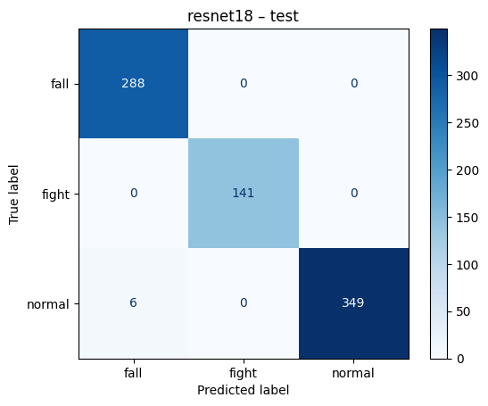
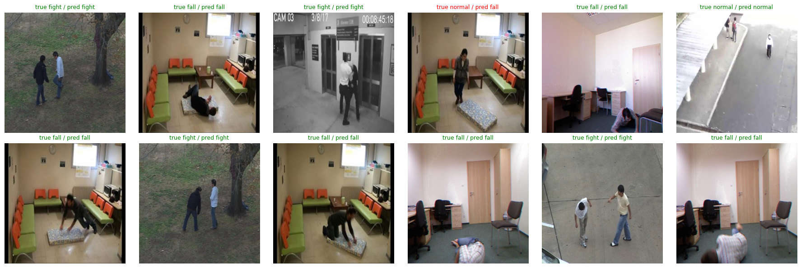
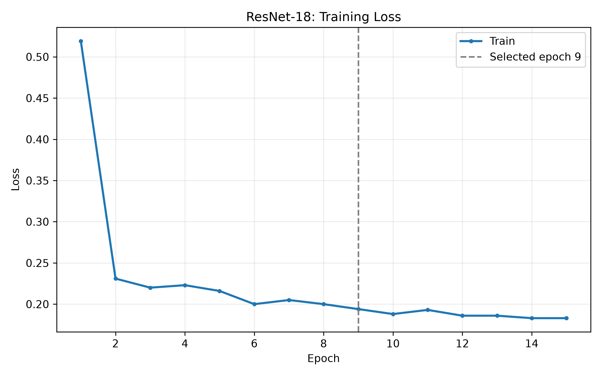
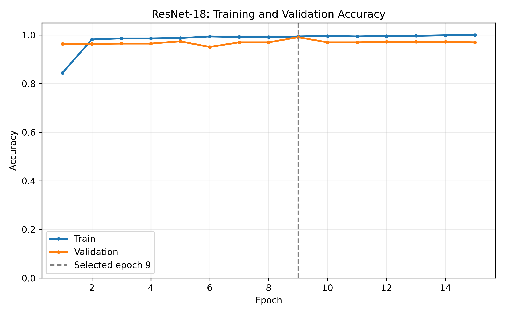
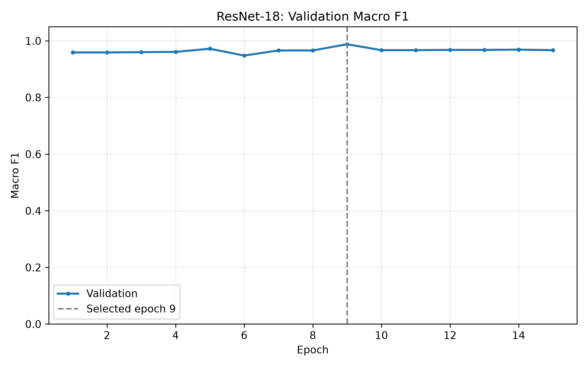
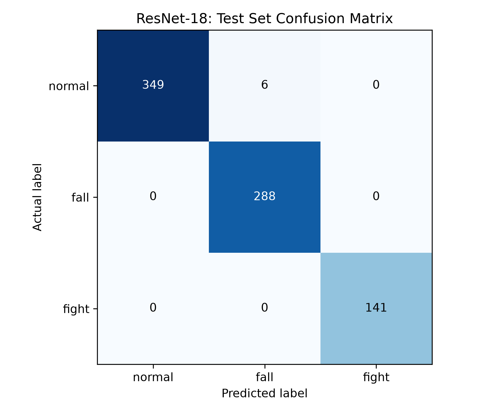
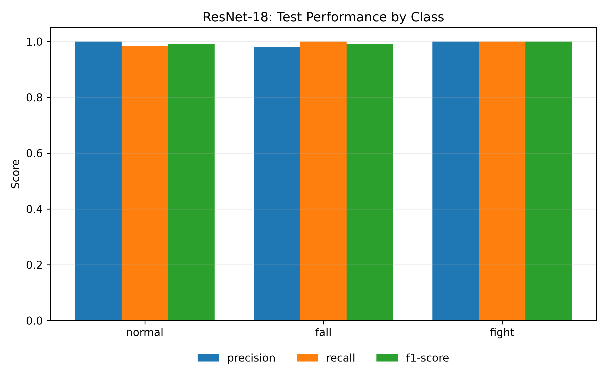

# Abnormal Crowd Behavior Detection with ResNet-18

Frame-level classification of surveillance images into **normal**, **fall** and **fight** using an ImageNet-pretrained ResNet-18.

> Part of the [DL-proj](https://github.com/anikagupta2403/DL-proj) comparison of 2D CNN, 3D CNN and Transformer models. See `main` for the project overview.

| | |
|---|---|
| Run | [`2d_cnn_resnet18.ipynb`](2d_cnn_resnet18.ipynb) (executed on Kaggle, with outputs) |
| Weights | [`best_resnet18.pt`](best_resnet18.pt) (44.8 MB, best epoch 9) |
| Figures | [`results/`](results/) |

The run was done on Kaggle (GPU). The Custom CNN and ViT use the same data pipeline, split and seed, so their results are directly comparable; the 3D CNN uses the same split.

---

## 1. Dataset

**Source:** [Roboflow Universe – Abnormal Behavior Detection v1](https://universe.roboflow.com/abnormal-behavior-detection/abnormal-behavior-detection-5geje/dataset/1) (CC BY 4.0), exported in YOLOv8 format.
It has 3,709 images, already resized to 640×640 by Roboflow, with no augmentation. The frames come from several public surveillance and fall-detection video sets, including UR Fall (`fall-xx-cam0`, `adl-xx-cam0`) and fight sequences (`seqN-frame_*`, `fiNNN-frame_*`).

### Preprocessing pipeline

```
Raw dataset (Roboflow export, YOLOv8 format)          3,709 images
  ↓ Data loading            parse data.yaml + one YOLO label file per image
  ↓ Data cleaning           corrupt-image check; remap unnamed classes 0/1/2
  ↓ Duplicate removal       drop 109 byte-identical images (MD5)             → 3,600
  ↓ Annotation validation   label format and box range checks; drop 1 empty label → 3,599
  ↓ Class handling          6 raw classes → 3; check balance; class-weighted loss
  ↓ Resizing                640×640 → 224×224
  ↓ Normalization           pixels scaled to [0, 1], then ImageNet mean/std
  ↓ Augmentation            flip, colour jitter, random crop (train set only)
  ↓ Train / Val / Test      group-aware split by source video
Final dataset                                          3,599 images
```

**1. Data cleaning and annotation validation.** The validation cell produced:

| Check | Result |
|---|---|
| Corrupt or unreadable images | 0 |
| Bounding boxes checked | 7,357 |
| Malformed label lines | 0 |
| Out-of-range boxes (coords outside [0, 1]) | 0 |
| Empty label files | 1 (dropped) |
| Exact duplicate images removed | **109** |
| Near-duplicate clusters (256-bit dHash) | 63 |
| Near-duplicate clusters spanning more than one video group | 15 |

The 109 exact duplicates are frames Roboflow exported twice under different hashes. Near-duplicate *consecutive* frames are not deleted; the group-aware split (step 4) handles them. Of the 15 clusters that span groups, 14 are frames from *different* UR Fall daily-activity videos shot by the same fixed camera in the same room. The remaining one is two adjacent frames on either side of a 100-frame block boundary.

**2. Class merging.** `data.yaml` lists 6 classes: `['0', '1', '2', 'fall', 'fight', 'normal']`. Looking at the images and how labels co-occur shows that the numbered classes are a second annotation scheme for the same behaviors: `0 → normal`, `1 → fall`, `2 → fight` (see [`results/label_sanity_check.png`](results/label_sanity_check.png)).

**3. One label per image.** If any box in the image is *fight*, the image is labeled **fight**. Otherwise, if any box is *fall*, it is **fall**. Otherwise it is **normal**. After cleaning, the classes are balanced: **1,200 fall / 1,199 fight / 1,200 normal**.

**4. Splitting by video.** Roboflow's original train/valid split alternates consecutive frames from the same clips (frame 4 → train, 15 → valid, 20 → train, …), so near-duplicate frames appear on both sides and inflate validation scores. We grouped the images by source video (218 groups). The two long numbered sequences have no video ID, so we cut them into blocks of 100 consecutive frames. We then split with `StratifiedGroupKFold` (≈ 60 / 20 / 20) so that **no video is in more than one split**.

| Split | fall | fight | normal | Total |
|---|---|---|---|---|
| Train | 668 | 725 | 681 | 2,074 |
| Validation | 244 | 333 | 164 | 741 |
| Test | 288 | 141 | 355 | 784 |
| **Total** | 1,200 | 1,199 | 1,200 | 3,599 |

Videos differ in length, and whole videos must stay in one split, so the per-split class proportions are uneven even though the full dataset is balanced.

### Resizing, normalization and augmentation
- **Resizing:** 224×224, the standard input size for ResNet-style CNNs. Roboflow's 640×640 is meant for YOLO detection.
- **Normalization:** `ToTensor()` scales pixels to [0, 1], then ImageNet mean/std normalization is applied, which the pretrained ResNet expects.
- **Augmentation (training only):** `RandomResizedCrop(224, scale=(0.6, 1.0))`, `RandomHorizontalFlip`, `ColorJitter(0.3, 0.3, 0.3, 0.05)` (brightness, contrast, saturation, hue). Validation and test images are only resized and normalized.
- **Mosaic augmentation was not used.** Mosaic stitches 4 images into one. That works for object detection, where every box keeps its own label, but in image classification the stitched image could contain normal, fall and fight at once and would have no single correct label.

---

## 2. Model: ResNet-18 (ImageNet-pretrained, fine-tuned)

**Why we selected it**
- The dataset is small (~2.1k training images). Transfer learning from ImageNet gives the model general visual features (edges, textures, human shapes and poses) that it would otherwise have to learn from very little data.
- ResNet-18 is a well-understood baseline. At 11.2M parameters it is light enough to fine-tune in a few minutes on a Kaggle T4 GPU.
- Its residual connections keep training stable when the whole network is fine-tuned.

**How it works**
- It is a deep 2D CNN made of residual blocks. Each block learns a residual function *F(x)* and outputs *F(x) + x*. This identity shortcut lets gradients pass straight through the block, which avoids the vanishing-gradient problem in deep networks.
- **Structure:** a 7×7 convolution stem and max-pool, then 4 stages of 2 BasicBlocks each (64 → 128 → 256 → 512 channels, with resolution halved at each stage), then global average pooling and a fully connected layer.
- **Our change:** we replaced the 1000-class ImageNet head with `Dropout(0.3) → Linear(512, 3)` and fine-tuned the whole network end to end.

**Implementation**
```python
m = torchvision.models.resnet18(weights=torchvision.models.ResNet18_Weights.DEFAULT)
m.fc = nn.Sequential(nn.Dropout(0.3), nn.Linear(m.fc.in_features, len(CLASSES)))
```

**Parameters used**

| Hyperparameter | Value |
|---|---|
| Input size | 224 × 224 × 3 |
| Trainable parameters | 11.18 M |
| Epochs | 15 |
| Batch size | 32 |
| Optimizer | AdamW, weight decay 1e-4 |
| Learning rate | 3e-4 (max), OneCycle schedule |
| Loss | Cross-entropy, class-weighted, label smoothing 0.05 |
| Precision | Mixed (AMP, fp16) |
| Checkpoint selection | Best validation macro-F1 (epoch 9, val macro-F1 = 0.988) |
| Seed | 42 |

**Results**

Training converged quickly: validation macro-F1 was 0.96 after the first epoch and peaked at 0.988 at epoch 9 ([curves](results/resnet18_training_curves.png)).

Test set (784 images, from videos the model never saw):

| Class | Precision | Recall | F1 | Support |
|---|---|---|---|---|
| fall | 0.980 | 1.000 | 0.990 | 288 |
| fight | 1.000 | 1.000 | 1.000 | 141 |
| normal | 1.000 | 0.983 | 0.991 | 355 |
| **Macro avg** | **0.993** | **0.994** | **0.994** | 784 |
| **Accuracy** | | | **0.992** | 784 |

Confusion matrix (rows are the true class):

| | pred fall | pred fight | pred normal |
|---|---|---|---|
| **fall** | 288 | 0 | 0 |
| **fight** | 0 | 141 | 0 |
| **normal** | 6 | 0 | 349 |



Only 6 of 784 test frames are misclassified, all of them **normal → fall**. Every fall and fight frame is detected.

Sample test predictions (green = correct, red = wrong):



The one error in this sample (top row, 4th) is a person **standing** next to the mattress in a fall-dataset room. The model predicts *fall*, which suggests the room and the mattress, not the pose, drove the decision.

---

### Graphs

The same set of graphs as the 3D CNN branch. The dashed line marks epoch 9, whose weights were kept for testing. The notebook logged only training loss per epoch (no validation loss) and only validation macro-F1 (no training F1), so those curves have a single line.

| | |
|---|---|
|  |  |
|  |  |
|  | |

## 3. Comparison with the other models

All four models are tested on the same held-out videos. The 2D models are scored on the same 784 test frames; the 3D CNN on 84 clips from the test videos with usable filenames.

| | ResNet-18 | Custom CNN | ViT-B/16 | 3D CNN |
|---|---|---|---|---|
| Input | 1 frame | 1 frame | 1 frame | 4-frame clip |
| Parameters | 11.18 M | 1.17 M | 85.80 M | ~0.07 M |
| Pretrained | ImageNet | No | ImageNet | No |
| **Test accuracy** | **0.992** | 0.969 | 0.985 | 0.881 |
| **Test macro-F1** | **0.994** | 0.969 | 0.987 | 0.873 |
| Fall recall | 1.000 | 1.000 | 0.969 | 1.000 |
| Normal recall | 0.983 | 0.932 | **0.992** | 0.643 |

- **ResNet-18 is the best model overall**, with only 6 errors out of 784 test frames.
- **Pretraining matters more than size.** ResNet-18 beats the Custom CNN trained from scratch (10× fewer parameters) by 2.5 points of macro-F1, but it also beats the ViT (8× more parameters).
- Details: [`2d-cnn`](https://github.com/anikagupta2403/DL-proj/tree/2d-cnn) (Custom CNN), [`transformer`](https://github.com/anikagupta2403/DL-proj/tree/transformer) (ViT), [`3d-cnn`](https://github.com/anikagupta2403/DL-proj/tree/3d-cnn) (3D CNN).

---

## 4. Evaluation Metrics

The model is evaluated on the group-aware test split (784 images), which contains videos not seen during training or model selection.

- **Accuracy** is the fraction of correctly classified frames. It can hide weak performance on one class, especially because the test split's class mix is uneven (141 fight vs. 355 normal).
- **Precision (per class)** is TP / (TP + FP): of the frames flagged as *fight*, how many really are fights. Low precision means false alarms.
- **Recall (per class)** is TP / (TP + FN): of the real *fight* frames, how many the model caught. In surveillance, missing an incident (low recall on abnormal classes) usually costs more than a false alarm.
- **F1-score** is the harmonic mean of precision and recall.
- **Macro-F1** is the unweighted mean of the per-class F1 scores. It is the **main metric** and is also used to pick the best checkpoint, because it weights every class equally.
- **Confusion matrix** shows which classes get confused with each other, e.g. normal → fall here.

---

## 5. Limitations

- **Scene can give away the class.** Most fall frames come from a few indoor rooms and most fight frames from outdoor scenes, so a CNN can partly rely on the background instead of the behavior. The group split prevents identical clips from leaking across splits, but scenes still repeat across clips (e.g. the UR Fall room shared by many videos). The error in the sample predictions, a person standing in a fall room predicted as *fall*, is an example of this. This may explain the near-perfect scores. The scores should not be read as proof that the models generalize to new cameras.
- **Small, uneven test split.** The test split has only 141 fight frames, from a limited number of videos, so per-class scores can change by a few points with a different split.
- **No temporal information.** A 2D CNN sees one frame at a time, while fights and falls are defined by motion.

---

## 6. How to Reproduce

1. Download the dataset from Roboflow (format: **YOLOv8**) and upload it as a Kaggle dataset.
2. Open `2d_cnn_resnet18.ipynb` on Kaggle, set **Accelerator → GPU** and **Internet → on** (for the pretrained weights), and point `DATA_ROOT` at the dataset. Settings: `MODEL = "resnet18"`, `EPOCHS = 15`, `LR = 3e-4`.
3. Restart the session after changing the accelerator, then click **Run All**. The best checkpoint is saved as `best.pt`.

Requirements: Python 3, PyTorch, torchvision, scikit-learn, pandas, matplotlib, Pillow, PyYAML (all preinstalled on Kaggle).
